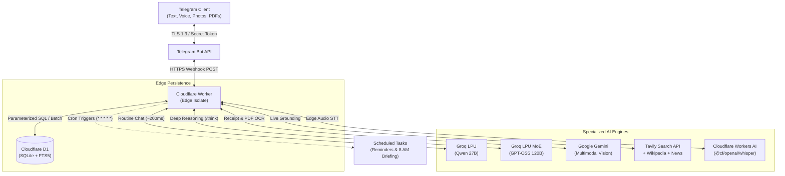

# F.R.I.D.A.Y. — Proprietary AI Executive Assistant & Cashflow Bot

<p align="center">
  
  
  
  
  
  
  
  
</p>

**F.R.I.D.A.Y.** is an ultra-fast, high-intelligence personal AI executive assistant built for Telegram in Cambodia. Engineered directly on serverless Cloudflare Workers and Cloudflare D1 with a specialized multi-AI engine architecture (Groq LPU, Google Gemini, and Cloudflare Workers AI), F.R.I.D.A.Y. manages dual-currency cashflow, engineering work logs, reminders, live web search, and voice interactions with sub-second execution speeds worldwide.

---

## ⚡ Specialized AI Architecture

F.R.I.D.A.Y. routes each feature to a specialized AI model optimized for that exact workload:

| Feature Domain | Engine & Model | Target Latency | Purpose |
| :--- | :--- | :--- | :--- |
| **Conversational Chat & Logs** | **Groq LPU** (`qwen/qwen3.8-27b`) | `~200ms` | Instant sub-second conversational answers, expense logging, and chit-chat |
| **Deep Reasoning (`/think`)** | **Groq LPU** (`openai/gpt-oss-120b`) | `~600ms` | Flagship 120B MoE for complex mathematical runway analysis, strategic advisory, and logic |
| **Receipt & Bank Slip OCR** | **Google Gemini** Multimodal Vision | `~800ms` | Automatic extraction of ABA Bank, Bakong KHQR, Acleda slips, and printed receipts |
| **PDF Statements & Invoices** | **Google Gemini** PDF Analyzer | `~1.2s` | Full monthly bank statement reconciliation and itemized transaction imports |
| **Real-Time Web Grounding** | **Tavily AI + Wikipedia + Gemini** | `~900ms` | Live weather, crypto spot prices, sports scores, and verified breaking news |
| **Speech-to-Text (STT)** | **Cloudflare Workers AI** (`whisper`) | `~400ms` | Instant edge voice transcription for audio messages and voice notes |
| **Neural Voice (TTS)** | **Neural Streaming Audio** | `~300ms` | High-fidelity British English & Khmer script speech playback |

---

## 📱 User Guide: How to Use F.R.I.D.A.Y.

### 1. Daily Chit-Chat & Voice Notes
* **Natural Conversation**: Talk directly without rigid bot prefixes (*"Good morning Friday"*, *"How is my day looking?"*).
* **Two-Way Voice**: Send a Telegram voice message, and Friday transcribes it and replies with clean text or a spoken voice message.
* **Auto-Voice Mode**: Toggle `/voice on` to have Friday speak all answers aloud, or `/voice off` for silent text.
* **Read Aloud**: Reply to any message with `/speak` to have Friday read it aloud with natural cadence.

### 2. Deep Thought Mode (`/think`)
When you need deep mathematical runway analysis, complex business decisions, or multi-angle strategic logic, prefix your query with `/think`:
* `/think can I afford a $1,200 laptop given my remaining runway this month?`
* `/think how should I allocate my savings versus discretionary burn rate?`
Friday engages her flagship 120B parameter reasoning engine to deliver structured, comprehensive executive guidance.

### 3. Autonomous Multi-Action Execution
Friday can execute multiple tasks in a single breath without needing separate commands:
> *"Hey Friday, I just paid $8.50 for lunch with Jinie, remind me at 3:30 PM to review the pull request, and note down that she loves matcha lattes."*

Friday will simultaneously:
1. Log an expense of `$8.50` under `Food`.
2. Schedule a reminder at `15:30` for *"Review the pull request"*.
3. Save a long-term personal memory: *"Jinie loves matcha lattes"*.

### 4. Financial Defense & Cashflow Tracking
* **Natural Logging**:
  * `5 coffee` ➔ Logs `$5.00` expense under `Coffee`
  * `12000 lunch` ➔ Logs `12,000 ៛` expense under `Food`
  * `+500 salary` or `earned $40 freelance` ➔ Credits your income ledger
* **Dual-Currency Telemetry**: Seamlessly converts between **USD ($)** and **Cambodian Riel (៛)** at `1 USD = 4,000 KHR`. Switch display currency anytime via `/settings` or by typing `"switch to KHR"`.
* **Instant Mistake Correction**:
  * Say *"40$ was income not expense"* ➔ Friday automatically reverses the wrongful expense and credits income.
  * Say `undo` or `/undo` ➔ Immediately purges the most recent transaction.
* **Affordability Engine**:
  * Ask *"Can I afford a $60 dinner?"* ➔ Friday calculates your safe daily discretionary allowance against fixed obligations and remaining month days.

### 5. Bank Receipt & PDF Invoice OCR
* **Snap a Receipt or Bank Slip**: Send a photo of an ABA Bank transfer, Bakong KHQR receipt, Acleda slip, or supermarket bill. Friday extracts the amount, currency, merchant, and category with 1-tap confirmation.
* **Send Bank Statements (PDF)**: Upload an official monthly bank PDF statement. Friday analyzes the statement, reconciles total inflows/outflows, and imports all itemized transactions automatically.

### 6. Engineering Work Journal & Standups
* **Log Accomplishments**: Type `done Fixed payment race condition in worker` to record a task with timestamp.
* **Scrum Standup (`/standup`)**: Generates formatted Yesterday, Today, and Blockers updates with a 1-tap copy block ready for Slack or Microsoft Teams.
* **Executive Polish (`/standup polish`)**: Transforms raw technical notes into executive management summaries.

### 7. Natural Reminders & Daily Briefing
* **Natural Reminders**:
  * `remind in 25m check deployment build`
  * `remind 17:30 call mom`
* **Automated Morning Greeting**: Pushed daily at 08:00 AM ICT via Cloudflare cron triggers (toggle via `/briefing on` / `/briefing off`).

---

## 📋 Comprehensive Command Reference

### Executive Intelligence & System
| Command | Shortcut | Description |
| :--- | :--- | :--- |
| `/hub` | `/start`, `/menu` | Open interactive visual Command Center |
| `/briefing` | `/status` | Tactical status briefing covering cashflow burn and tasks |
| `/think <query>` | — | Trigger Deep Thought 120B MoE reasoning engine |
| `/ask <query>` | `/ai`, chat directly | Natural language query to F.R.I.D.A.Y. copilot |
| `/search <query>` | `/web`, `/google` | Real-time live web search grounding (news, sports, weather) |
| `/voice on` / `off` | `/speak on` | Toggle auto-voice audio responses |
| `/speak` | `/talk`, `/say` | Read aloud last message or answered question |
| `/remember <fact>` | `/memorize` | Store personal preference or rule in long-term memory |
| `/memory` | `/memories` | View all stored long-term personal memories |
| `/forget <id>` | `/forget all` | Delete specific memory entry or wipe memory matrix |
| `/reset` | `/newchat` | Flush conversation context for a clean slate |

### Cashflow & Ledgers
| Command | Natural Shortcut | Description |
| :--- | :--- | :--- |
| `/today` | `/t`, `today` | View today's itemized transaction ledger |
| `/summary` | `/s` | Monthly spending breakdown, top categories & budget gauge |
| `/month` | `/m` | Monthly financial telemetry report |
| `/undo` | `undo`, `/cancel` | Purge and reverse the most recent transaction |
| `/add <amt> <cat>` | `5 coffee`, `10000 lunch` | Quick expense recording (zero command friction) |
| `/income <amt>` | `+500 salary`, `40$ income` | Quick income recording |
| `/budget <amt>` | `/b 300 usd` | Set monthly spending threshold with auto-warnings |
| `/export` | `/backup` | Export complete ledger database as CSV file |

### Engineering Work Journal
| Command | Natural Shortcut | Description |
| :--- | :--- | :--- |
| `/work` | `/w`, `tasks` | Open Work Journal dashboard |
| `/done <task>` | `did ...`, `finished ...` | Log work accomplishment with timestamp |
| `/standup` | `/su`, `standup` | Generate Scrum standup report with 1-tap copy block |
| `/standup polish` | — | Transform notes into executive management standup |
| `/report` | `/report last` | Generate monthly accomplishments report |
| `/report polish` | `/polish` | Synthesize accomplishments into quarterly review |

---

## 🏛️ System Architecture



---

## 🚀 Setup & Deployment

### Prerequisites
* [Node.js](https://nodejs.org/) (v18+)
* [Cloudflare Account](https://cloudflare.com/) with Wrangler CLI
* Telegram Bot Token from [@BotFather](https://t.me/BotFather)
* API Keys:
  * **Groq API Key** from [Groq Console](https://console.groq.com/) *(Free tier)*
  * **Google Gemini API Key** from [Google AI Studio](https://aistudio.google.com/) *(Free tier)*
  * **OpenRouter API Key** *(Optional fallback)*
  * **Tavily API Key** from [Tavily AI](https://tavily.com/) *(Optional live search)*

### 1. Clone Repository
```bash
git clone https://github.com/Sopheaktraleng/friday-ai.git
cd friday-ai
npm install
```

### 2. Configure Cloudflare D1 Database
Create your D1 database:
```bash
npx wrangler d1 create cashflow_bot
```

Bind the database in `wrangler.toml`:
```toml
[[d1_databases]]
binding = "DB"
database_name = "cashflow_bot"
database_id = "YOUR_DATABASE_ID_HERE"
```

Apply database migrations:
```bash
npm run db:migrate:remote
```

### 3. Configure Secrets
Set your environment secrets securely in Cloudflare:
```bash
npx wrangler secret put TELEGRAM_BOT_TOKEN
npx wrangler secret put WEBHOOK_SECRET
npx wrangler secret put GROQ_API_KEY
npx wrangler secret put GEMINI_API_KEY
npx wrangler secret put OPENROUTER_API_KEY # Optional
npx wrangler secret put TAVILY_API_KEY     # Optional
```

### 4. Deploy & Connect Webhook
Deploy the worker to Cloudflare Workers:
```bash
npx wrangler deploy
```

Register your webhook with Telegram:
```bash
export TELEGRAM_BOT_TOKEN="your-telegram-token"
export WEBHOOK_SECRET="your-webhook-secret"
export WORKER_URL="https://cashflow-bot.your-subdomain.workers.dev"
npm run set:webhook
```

---

## 🧪 Testing & Verification

The test suite runs with [Vitest](https://vitest.dev/):
```bash
npm test
```

All **209 unit tests** verify:
* Specialized AI routing (Groq LPU, Groq MoE, Gemini, Workers AI)
* Deep Thought no-fallback protocol (`/think`)
* Bank PDF statement analysis & receipt OCR extraction
* Autonomous multi-action execution (`actions: [...]`)
* SQLite D1 batching & FTS5 historical search
* Speech synthesis (TTS) & language detection
* Webhook timing-safe authentication and security

---

## 📄 License & Credits

* Engineered with ❤️ by **Tra** in Cambodia.
* Licensed under the [ISC License](package.json).
