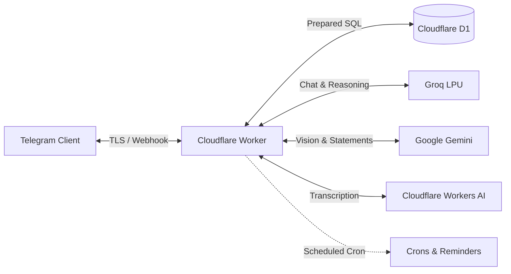

# Friday AI

<p align="center">
  
  
  
  
  
  
</p>

High-performance personal assistant and cashflow bot built on serverless Cloudflare Workers and Cloudflare D1. Delivers dual-currency ledger tracking, lending and IOU management, engineering work journals, automated standups, smart reminders, and voice interactions.

---

## Architecture



---

## Core Capabilities

### 1. Cashflow & Dual-Currency Ledger
* **Natural Logging**: Log transactions directly without command syntax:
  * `5 coffee` or `3.50 grab` ➔ Outflow under category
  * `+500 salary` or `40$ freelance` ➔ Inflow credited to ledger
  * `undo` or `/undo` ➔ Reverses the most recent entry
* **Dual Currency (USD / KHR)**: Official daily exchange rate synced with the National Bank of Cambodia (NBC). Toggle currency anytime via `/settings`.
* **Receipt & Statement OCR**: Upload ABA Bank transfers, Bakong KHQR slips, printed receipts, or monthly PDF statements for automatic parsing and reconciliation.

### 2. Lending & IOU Management
* **Bank Balance Parity**: Loans immediately reflect in your net balance:
  * `bob borrow from me 25$ at 1st nov` or `/lend 50 Alex lunch` ➔ Records loan and logs cash outflow (`-$`) under `🤝 Loan`.
  * Tapping **✅ Settled** logs repayment inflow (`+$`) under `🤝 Loan Repayment`, restoring your balance.
  * Tapping **❌ Cancel** deletes the loan and voids the outflow transaction.
* **Natural Date Extraction**: Automatically parses relative dates (`today`, `yesterday`) or calendar dates (`1st nov`, `2026-11-01`).
* **Active Loans Dashboard**: Access all pending loans and 1-tap settlement via `/debts`.

### 3. Engineering Work Journal & Standups
* **Work Log**: Type `done Fixed database connection race condition` to log accomplishments.
* **Automated Standups**: `/standup` compiles formatted updates ready for Slack or Microsoft Teams. Use `/standup polish` for executive summaries.

### 4. Smart Reminders & Briefings
* **Contextual Alerts**: `remind 17:30 Client call` or `remind in 20m Check deployment`.
* **Daily Morning Briefing**: Automated daily summary delivered at 08:00 AM ICT covering cashflow burn, exchange rates, and tasks.

### 5. Multi-AI Copilot & Voice
* **Deep Thought Mode (`/think <query>`)**: Uses 120B MoE reasoning for complex runway analysis and planning.
* **Grounding (`/search <query>`)**: Real-time web search for live news, weather, and financial data.
* **Voice Messaging**: Voice notes are transcribed with Whisper and answered with natural speech synthesis.

---

## Command Reference

### Finance & Loans
| Command | Natural Format | Description |
| :--- | :--- | :--- |
| `/today` | `today` | View today's transaction ledger & net balance |
| `/summary` | `summary` | Monthly spending breakdown and category insights |
| `/lend <amt> <person> [note]` | `bob borrow 25$ [date]` | Log a loan and deduct cashflow outflow |
| `/debts` | `debts` | View outstanding loans with 1-tap settlement |
| `/export` | `export` | Export transaction history to CSV |
| `/rate` | — | View official NBC USD ⇄ KHR exchange rate |
| `/budget <amt>` | `/b 300 usd` | Set monthly spending threshold |

### Work & Tasks
| Command | Shortcut | Description |
| :--- | :--- | :--- |
| `/tasks` | `/w` | View today's completed accomplishments |
| `/done <task>` | `done ...` | Log completed task with timestamp |
| `/standup` | `/su` | Generate Scrum standup report |
| `/standup polish` | — | Synthesize notes into executive summary |

### Assistant & System
| Command | Shortcut | Description |
| :--- | :--- | :--- |
| `/hub` | `/start`, `/menu` | Open interactive visual Command Center |
| `/search <query>` | `/web` | Live web search grounding |
| `/think <query>` | — | Trigger Deep Thought reasoning engine |
| `/voice on\|off` | — | Toggle audio voice playback |
| `/settings` | — | Display currency toggle & preferences |
| `/reset` | `/newchat` | Reset active conversation context |

---

## Quickstart

### Prerequisites
* [Node.js](https://nodejs.org/) (v18+)
* Cloudflare account with [Wrangler CLI](https://developers.cloudflare.com/workers/wrangler/)
* Telegram Bot Token from [@BotFather](https://t.me/BotFather)

### Installation & Deployment

```bash
# 1. Clone repository
git clone https://github.com/Sopheaktraleng/friday-ai.git
cd friday-ai
npm install

# 2. Initialize Cloudflare D1 Database
npx wrangler d1 create cashflow_bot
npm run db:migrate:remote

# 3. Configure secrets
npx wrangler secret put TELEGRAM_BOT_TOKEN
npx wrangler secret put WEBHOOK_SECRET
npx wrangler secret put GROQ_API_KEY
npx wrangler secret put GEMINI_API_KEY

# 4. Deploy worker
npm run deploy

# 5. Connect Telegram Webhook
npm run set:webhook
```

---

## Verification & Testing

Vitest runs automated tests covering database queries, transaction reconciliations, parser edge cases, and callback integrity:

```bash
npm test
```

```text
Test Files  9 passed (9)
Tests       283 passed (283)
Duration    ~350ms
```

---

## License

ISC License. Built by Sopheaktra Leng.
